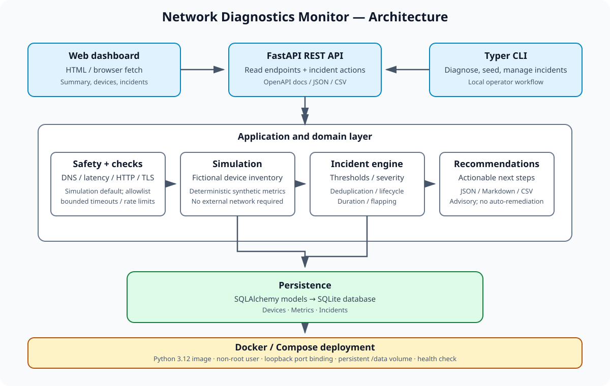

# Network Diagnostics Monitor

A simulated-first network troubleshooting toolkit designed to demonstrate practical technical-support and networking skills. It combines DNS diagnostics, latency/loss measurements, HTTP/TLS checks, and explicit safeguards around live probes.

## Stage 1 status

Stage 1 implements the Python package scaffold, configuration, safety guardrails, simulated and live check engines, a `diagnose` CLI command, tests, and GitHub Actions CI. Stage 2 adds persistence and incident handling; Stage 3 adds advisory troubleshooting recommendations and JSON, Markdown, and CSV reports; Stage 4 exposes the persisted data through a FastAPI API and local dashboard.

## Safety and scope

- **Simulated mode is the default** and does not access the network.
- Live checks are restricted to `NDM_ALLOWED_TARGETS`; targets outside the list are rejected.
- Private, link-local, multicast, and metadata-service IP ranges are blocked unless lab ranges are explicitly enabled. Loopback is permitted only when explicitly allowlisted.
- No port scanning or traffic floods are implemented. Checks use hard timeouts, one probe at a time, and a process-local minimum interval.
- The allowlist is a permission boundary, not a guarantee that a target is safe to probe. Only use live mode on targets you are authorized to test.

## Quick start

Requires Python 3.12.

```bash
python -m venv .venv
# Windows: .venv\Scripts\activate
# macOS/Linux:
source .venv/bin/activate
python -m pip install -e ".[dev]"
cp .env.example .env
network-diagnostics diagnose example.com
```

By default, this prints explicitly labelled simulated results. For a live check, use an allowlisted target and opt in:

```bash
network-diagnostics diagnose example.com --mode live
```

The CLI's live mode is subject to the allowlist, blocked-range policy, timeout, and rate limiter. The sample configuration includes `example.com`, `localhost`, `127.0.0.1`, `cloudflare-dns.com`, and `1.1.1.1`; adjust it only for targets you control or have permission to check.

## Development checks

These are the same checks used by CI:

```bash
ruff check .
ruff format --check .
pytest --cov=network_diagnostics_monitor --cov-report=term-missing --cov-fail-under=85
```

Tests use deterministic simulated data and mocks; they must not make real network requests.

## Stage 2: monitoring and incidents

The monitoring database uses SQLAlchemy 2 and SQLite. By default it creates `./network_diagnostics.db`; set `NDM_DATABASE_URL` to choose another SQLAlchemy URL. No database or network service is required.

```bash
# Create ten fictional devices, generate three days of hourly synthetic metrics,
# and evaluate incidents. All generated observations are labelled simulation.
network-diagnostics seed
network-diagnostics seed --days 5 --interval-minutes 30 --seed 42
network-diagnostics incidents
network-diagnostics incidents --status open
network-diagnostics acknowledge 1 --by "Helpdesk technician"
network-diagnostics resolve 1
```

The simulator uses a fixed random seed by default and includes scripted scenarios such as DNS degradation, high latency and packet loss, HTTP 5xx errors, and intermittent availability. The same device/metric/timestamp combination is not inserted twice. Incident evaluation deduplicates active alerts, updates occurrence counts, classifies severity, resolves active incidents when the latest observation is healthy, and detects availability flapping from recent up/down transitions. TLS expiry is represented by synthetic days-remaining metrics; it does not inspect a real certificate.

## Stage 3: recommendations and reports

Stage 3 provides non-invasive, incident-specific troubleshooting guidance and report exports. Recommendations are advisory: the application does not apply configuration changes, restart devices, or run additional network probes. Confirm symptoms independently and follow your organisation's change-control process.

```bash
# Show recommendations for every recorded incident, or specify an incident ID
network-diagnostics recommendations
network-diagnostics recommendations 2

# Print a Markdown report to the terminal (default)
network-diagnostics report

# Export machine-readable JSON, spreadsheet-friendly CSV, or Markdown
network-diagnostics report --format json --output reports/monitoring-report.json
network-diagnostics report --format csv --output reports/incidents.csv
network-diagnostics report --format markdown --output reports/monitoring-report.md
```

Reports include device and metric counts, incident status/severity summaries, incident duration, lifecycle timestamps, flapping flags, and recommended next steps. Reports use persisted data only; synthetic records remain synthetic and should not be presented as evidence of a real outage. Output files are not committed automatically.

## Architecture (Stages 1–4)

- `config.py`: typed environment settings.
- `safety.py`: target allowlisting, IP-range restrictions, and process-local rate limiting.
- `checks/`: DNS, latency/loss, and HTTP/TLS engines. Each supports simulated and live execution.
- `cli.py`: Typer command line entry point (`diagnose`, `seed`, `incidents`, `acknowledge`, `resolve`).
- `models.py`: SQLAlchemy `Device`, `Metric`, and `Incident` models.
- `database.py`: SQLite-first engine, schema creation, and session helpers.
- `simulation.py`: fictional inventory and deterministic metric generator.
- `incidents.py`: threshold evaluation, deduplication, flapping detection, and incident lifecycle helpers.
- `recommendations.py`: advisory troubleshooting steps keyed to incident type.
- `reports.py`: structured report generation in JSON, Markdown, and CSV.
- `api.py`: FastAPI endpoints, incident lifecycle actions, and a responsive local dashboard.

## Stage 4: API and dashboard

Stage 4 provides a FastAPI read API, incident lifecycle actions, report endpoints, and a responsive local dashboard. The API does not expose live diagnostic probes; it reads persisted measurements and offers explicit incident acknowledgement/resolution actions. Dashboard actions use the same API and do not initiate network traffic to monitored devices.

Install the package with development dependencies, then start the local server from the repository root:

```bash
python -m pip install -e ".[dev]"
uvicorn network_diagnostics_monitor.api:app --host 127.0.0.1 --port 8000
```

Open `http://127.0.0.1:8000/` for the dashboard, `http://127.0.0.1:8000/docs` for interactive API documentation, or `http://127.0.0.1:8000/redoc` for the alternate API reference. Bind to `127.0.0.1` for local use. Do not expose the development server publicly without adding authentication, authorization, deployment hardening, and HTTPS.

Key endpoints include `GET /api/summary`, `GET /api/devices`, `GET /api/metrics`, `GET /api/incidents`, `GET /api/incidents/{id}/recommendations`, `POST /api/incidents/{id}/acknowledge`, `POST /api/incidents/{id}/resolve`, and `GET /api/reports/{json|markdown|csv}`. List endpoints support bounded result limits.

The dashboard uses browser-native JavaScript and CSS, with no external CDN or paid service dependency. Use `NDM_DATABASE_URL` to select the same SQLite database used by the CLI.

## Stage 5: packaging and deployment

A Dockerfile and Docker Compose setup are included for reproducible local demonstrations. The image uses Python 3.12, runs as a non-root user, defaults to simulated mode, and stores SQLite data in a persistent named volume. Compose publishes the dashboard only on `127.0.0.1:8000` and configures a health check.

```bash
docker compose build
docker compose up -d
docker compose run --rm app network-diagnostics seed
docker compose ps
docker compose logs app
```

Open <http://127.0.0.1:8000/>. See [the deployment guide](docs/DEPLOYMENT.md) for operations, backup/restore notes, environment variables, troubleshooting, and optional Render considerations. The hand-authored [SVG architecture diagram](docs/images/architecture.svg) is also included.

**Security limitation:** the current API has no authentication or authorization and is not safe for public exposure. Keep the service local; do not deploy it publicly until access controls and CSRF protections are implemented and reviewed. Render is optional and may require paid persistent storage for durable SQLite data. Docker can be run locally without a subscription.

## Architecture diagram



## Roadmap

1. **Stage 1:** safe diagnostics engines and CLI.
2. **Stage 2:** SQLite models, deterministic simulated devices/metrics, incident engine.
3. **Stage 3:** actionable troubleshooting recommendations and report exports (implemented).
4. **Stage 4:** FastAPI, REST API, responsive dashboard (implemented).
5. **Stage 5:** containerization, complete operations documentation, deployment guide, architecture diagram.

## Screenshots

Screenshots will be added after the dashboard is implemented in Stage 4.

## Why I built this

Network issues are often reported as vague symptoms: “the internet is slow” or “the site is down.” This project is intended to show a structured troubleshooting workflow—from reachability and DNS through application-level checks—while keeping a safe simulated mode for development and demonstrations.
