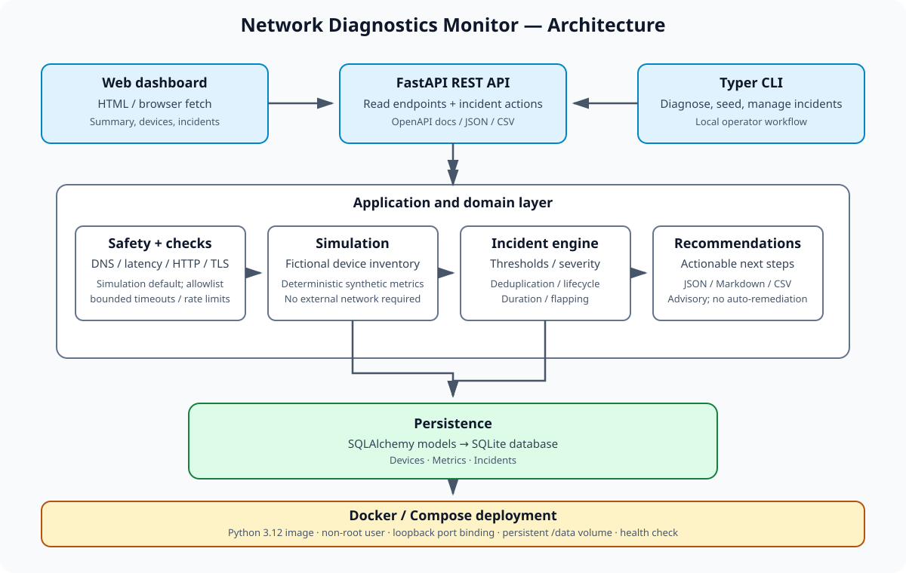

# Architecture

Network Diagnostics Monitor is a small, layered Python application. Everything runs in **simulated mode** by default; live checks are opt-in and restricted to an explicit allowlist.

## Modules

| Module | Responsibility |
|---|---|
| `config.py` | Typed settings read from `NDM_*` environment variables (pydantic-settings). |
| `safety.py` | Target allowlist, blocked IP ranges (private, link-local, multicast, cloud metadata, IPv4-mapped IPv6), safe DNS resolution and a process-local rate limiter. |
| `checks/dns.py` | DNS record checks (A, AAAA, CNAME, MX, NS, TXT), timing, and a two-resolver comparison. |
| `checks/latency.py` | Latency, jitter and packet loss using system `ping`, with a TCP-connect fallback when ICMP is unavailable. |
| `checks/http.py` | HTTP availability, redirects, expected status and keyword assertions, and TLS certificate expiry. |
| `models.py`, `database.py` | SQLAlchemy 2 models (`Device`, `Metric`, `Incident`), SQLite-first engine and sessions. |
| `simulation.py` | Ten fictional devices and a deterministic, seeded metric generator with scripted failure scenarios. |
| `incidents.py` | Chronological replay, threshold evaluation, de-duplication, severity, flapping detection and the incident lifecycle. |
| `diagnosis.py` | Pure rule-based findings across DNS, reachability, gateway/link quality, application and TLS layers. |
| `recommendations.py` | Advisory troubleshooting steps keyed by incident type. |
| `reports.py` | JSON, Markdown, formula-safe CSV, self-contained HTML and incident post-mortem reports built from persisted data. |
| `api.py` | FastAPI application, REST endpoints and the dashboard page. |
| `cli.py` | Typer command line interface. |

## Data model

- **Device**: a fictional or explicitly configured asset (name, type, hostname, location, simulated flag).
- **Metric**: a timestamped measurement (name, value, unit, status, source, details). A compound index supports device, metric and time queries.
- **Incident**: kind, severity, lifecycle status (`open`, `acknowledged`, `resolved`), start, acknowledgement and resolution timestamps, duration, occurrence count and a flapping flag.

The schema is created with SQLAlchemy `create_all`; there is no migration tooling yet. Set `NDM_DATABASE_URL` to use another database.

## Simulation

`network-diagnostics seed` creates ten fictional devices and generates deterministic metric history (default: three days, hourly) from a fixed random seed. Re-running the same window does not duplicate rows. The scripted scenarios are:

- DNS outage on the DNS server
- High latency and packet loss on the edge router and VPN gateway
- HTTP 503 responses on the web server
- Intermittent availability on an access point (flapping)
- A synthetic TLS certificate close to expiry

All generated rows carry the source `simulation`. No network traffic is produced.

## Incident engine

Default thresholds live in `incidents.DEFAULT_THRESHOLDS` and can be overridden programmatically. Seeded metrics are replayed chronologically per device and metric; abnormal runs open incidents, normal readings resolve them and record duration, and repeated abnormal samples increase `occurrence_count`. Replaying a seed rebuilds only replay-managed simulated incident kinds, so rerunning is idempotent and manual incidents are preserved. Flapping is detected from availability transitions.

## Recommendations and reports

Recommendations are transparent rules, not an automated root-cause engine: each incident type maps to ordered actions with a rationale and a way to verify the result. They are advisory and never change configuration or run probes.

Reports can be rendered as JSON, Markdown, formula-safe incident CSV, per-device summary CSV, self-contained responsive HTML, or one incident Markdown post-mortem. HTML escapes report values and contains no external assets. CSV cells with spreadsheet formula prefixes are protected with a leading apostrophe.

## API

| Method | Path | Purpose |
|---|---|---|
| GET | `/api/health` | Health status |
| GET | `/api/summary` | Device, metric and incident counts |
| GET | `/api/devices`, `/api/devices/{id}` | Device inventory |
| GET | `/api/devices/{id}/metrics`, `/api/metrics` | Recent measurements |
| GET | `/api/incidents`, `/api/incidents/{id}` | Filterable incident queue |
| POST | `/api/incidents/{id}/acknowledge` | Acknowledge an incident |
| POST | `/api/incidents/{id}/resolve` | Resolve an incident |
| GET | `/api/incidents/{id}/recommendations` | Advisory troubleshooting steps |
| GET | `/api/reports/{json,markdown,csv}` | Export report data |

List endpoints cap `limit` at 500. Unknown records return 404, invalid query parameters 422, and acknowledging a resolved incident 409. The API does not create devices, write metrics, change the allowlist or start probes. Interactive documentation is served at `/docs` and `/redoc`.

## Dashboard

The dashboard (`/`) uses plain HTML, CSS and JavaScript with no external CDN. It shows summary cards, the device inventory, the incident queue (with acknowledge, resolve and guidance actions) and the latest measurements. It follows the system light or dark theme and works on phone screens.

## Safety model

- Simulated mode is the default and never touches the network.
- Live targets must be listed in `NDM_ALLOWED_TARGETS`.
- Private, link-local, multicast, reserved and cloud-metadata addresses are blocked unless `NDM_ALLOW_LAB_RANGES=true`; loopback is allowed only when explicitly allowlisted. DNS answers are re-checked before connecting.
- Probes are sequential, bounded (1 to 5 per check), time-limited and rate-limited. There is no port scanning.
- HTTP checks do not follow redirects, so a redirect cannot lead outside the allowlist.

## Known limitations

- The API has no authentication or CSRF protection; keep it local (see [DEPLOYMENT.md](DEPLOYMENT.md)).
- The dashboard has no charts and no live "diagnose a target" panel yet; the diagnostic engines are available through the CLI.
- No scheduler or notification delivery.
- No migration tooling is provided yet; schema evolution requires review and a migration workflow.
